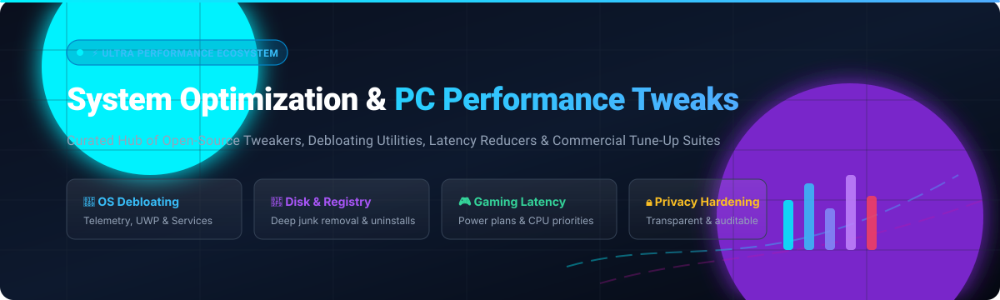

# ⚡ Awesome System Optimization & PC Performance Tweaks

  <strong>Curated Directory of Top SaaS/Proprietary Utilities & Open-Source Tools for Windows, Linux & macOS</strong>

  
  
  
  

---

## 📌 Table of Contents
- [📖 Overview & SEO Summary](#-overview--seo-summary)
- [📊 Sector Overview & Market Dynamics](#-sector-overview--market-dynamics)
- [🏢 SaaS & Proprietary Utilities](#-saas--proprietary-utilities)
- [💻 Open-Source GitHub Projects](#-open-source-github-projects)
- [🛠️ Recommended Optimization Stacks](#️-recommended-optimization-stacks)
- [🤝 How to Contribute](#-how-to-contribute)
- [⚠️ Safety & Disclaimer](#️-safety--disclaimer)

---

## 📖 Overview & SEO Summary

Welcome to the definitive guide to **System Optimization, OS Debloating, and PC Performance Tuning**. Whether you are an esports gamer aiming to minimize input latency, a software developer reclaiming gigabytes of disk space, or a system administrator hardening OS privacy baselines, this curated repository indexes battle-tested tools across:

- 🚀 **Windows 10 & 11 Debloating**: Strip telemetry, remove pre-installed bloatware/UWP packages, and disable redundant background services.
- 🧹 **Deep Disk & Registry Cleaning**: Safely shred residual caches, manage broken uninstalls, and eliminate duplicate files.
- 🎮 **Gaming Latency & Hardware Optimization**: Apply process priority adjustments, tune CPU governors, configure GPU driver clean installs, and deploy performance power profiles.
- 🛡️ **Privacy & Telemetry Hardening**: Audit OS telemetry, configure DNS/diagnostic restrictions, and prevent unwanted data transmission.

---

## 📊 Sector Overview & Market Dynamics

The global PC system optimization, cleaner, and utility software market is valued at approximately **$1.8 billion to $2.2 billion**, projected to grow steadily alongside rising demand for gaming hardware tuning, endpoint lifecycle extension, and telemetry-aware privacy configurations. 

The industry demonstrates a **moderately fragmented** market structure: while legacy consumer suites (such as Gen Digital's CCleaner and AVG TuneUp) retain substantial enterprise and retail distribution footprint, the ecosystem faces rapid decentralization driven by power users, gamers, and privacy advocates transitioning toward auditable, community-driven open-source utilities and modular PowerShell frameworks.

---

## 🏢 SaaS & Proprietary Utilities

The table below outlines established commercial and SaaS-enabled system optimization software, sorted descending by estimated parent company scale (annual revenue or market valuation).

| 🏢 Product | 💰 Starting Pricing | 🎁 Free Tier Limit | 📈 Company Scale (Est. Revenue / Valuation) | 🔍 Key Features |
| :--- | :--- | :--- | :--- | :--- |
| **[Razer Cortex](https://razer.com)** | $0.00 / free utility (Razer Ecosystem Monetization) | Free forever (100% features free without time limit; hardware ecosystem upsell) | **~$2.1 Billion** (Annual Revenue) | Proprietary game booster that auto-boosts RAM, stops background services, cleans junk files, and syncs cloud saves. |
| **[CCleaner](https://ccleaner.com)** *(Gen Digital)* | $29.95 / year (Professional 1 PC) | Free forever plan with basic temporary file cleaning & privacy sweeping (no driver updater, auto-cleaning, or scheduled tasks) | **~$3.8 Billion** (Gen Digital Annual Revenue) | Standard disk cleaning, registry check, driver updater, browser privacy clearing, and multi-PC cloud fleet management. |
| **[AVG TuneUp](https://avg.com)** *(Gen Digital)* | $39.99 / year (1 PC; renews at $69.99/yr) | 30-day full-featured free trial (no credit card required; limited to 30 days) | **~$3.8 Billion** (Gen Digital Annual Revenue) | Patented Sleep Mode technology to suspend resource-heavy background processes, automated registry maintenance, and software uninstaller. |
| **[System Mechanic](https://iolo.com)** *(RealDefense)* | $39.95 / year (System Mechanic standard) | Free forever version limited to basic disk cleanup and registry repair (no real-time CPU tuning or drive defrag) | **~$100 Million+** (RealDefense Valuation / Annual Rev) | Real-time automated processor tuning (LiveBoost), memory defragmentation, startup optimizer, and bloatware detection. |
| **[CleanMyMac / CleanMyPC](https://macpaw.com)** *(MacPaw)* | $39.95 / year or $89.95 one-time purchase | Free trial limited to clearing a maximum of 500 MB of disk junk and 1-time file scanning | **~$60 Million - $90 Million** (Annual Revenue) | High-performance disk cache cleaner, application uninstaller, malware removal scanner, and memory monitoring menu app. |
| **[Ashampoo WinOptimizer](https://ashampoo.com)** | $30.00 one-time purchase (frequently discounted from $50) | 30-day fully functional free trial (10 days baseline + 20 days upon email registration) | **~$30 Million - $50 Million** (Annual Revenue) | 30+ modular system utilities including SSD defrag, telemetry switcher, registry repair, system benchmarks, and auto-cleaner. |
| **[IObit Advanced SystemCare](https://iobit.com)** | $19.99 / year (Pro plan for 3 PCs) | Free forever plan limited to basic junk clean and system sweep (no deep registry cleanup, real-time protection, or internet boost) | **~$20 Million - $40 Million** (Annual Revenue) | AI-driven system cleanup, registry defragmentation, startup manager, internet performance acceleration, and scheduled background sweeps. |
| **[Glary Utilities](https://glarysoft.com)** | $39.95 / year (Pro plan for 3 PCs) | Free forever plan for personal non-commercial use with manual 1-Click Maintenance (no auto-update or automatic background maintenance) | **~$10 Million - $25 Million** (Annual Revenue) | 1-click system diagnostic and cleanup, disk repair, memory management, spyware detection, and context-menu customization. |
| **[Wise Care 365](https://wisecleaner.com)** | $29.95 / year or $59.95 lifetime (WiseCleaner) | Free forever plan offering basic PC checkup, disk cleaning, and system speedup (no automated silent updates or privacy protection) | **~$5 Million - $15 Million** (Annual Revenue) | Real-time system monitoring, registry cleaner, hardware overview, disk shredder, and startup item controller. |

---

## 💻 Open-Source GitHub Projects

Transparent, auditable, and community-maintained optimization suites, system cleaners, and privacy enhancers — **sorted descending by GitHub star count**.

| 💻 Project | ⭐ GitHub Stars | 🎯 Platform / Tech | 📝 Description |
| :--- | :--- | :--- | :--- |
| **[WinUtil](https://github.com/ChrisTitusTech/winutil)** |  | Windows / PowerShell & WPF | Chris Titus Tech's renowned multi-tool to debloat Windows 10/11, tweak background services, manage Windows Updates, and batch-install software via winget. |
| **[Win11Debloat](https://github.com/Raphire/Win11Debloat)** |  | Windows / PowerShell | Lightweight, configurable PowerShell script to strip pre-installed bloatware, disable telemetry, unpin start menu widgets, and streamline Windows 10 and 11. |
| **[Czkawka](https://github.com/qarmin/czkawka)** |  | Cross-Platform / Rust | Multi-threaded disk cleanup utility written in Rust to instantly find and purge duplicate files, empty directories, similar images, zero-byte files, and broken symlinks. |
| **[Bulk Crap Uninstaller](https://github.com/BCUninstaller/Bulk-Crap-Uninstaller)** |  | Windows / C# & .NET | High-power batch uninstaller with advanced residual file and registry key detection, unattended batch uninstallation, and support for Windows Store apps. |
| **[Windows10Debloater](https://github.com/Sycnex/Windows10Debloater)** |  | Windows / PowerShell | Pioneer script for removing bloatware, disabling Cortana, stopping edge telemetry, and reverting Windows diagnostic tracking. |
| **[Optimizer](https://github.com/hellzerg/optimizer)** |  | Windows / C# | Advanced portable configuration utility to disable Windows telemetry, Cortana, OneDrive, Xbox Live services, tune network latency, and repair common OS bugs. |
| **[System Informer](https://github.com/winsiderss/systeminformer)** |  | Windows / C | Modern successor to Process Hacker. Extremely powerful tool to inspect running processes, thread priorities, memory consumption, locked files, and network traffic. |
| **[Pearcleaner](https://github.com/alienator88/Pearcleaner)** |  | macOS / Swift | Free, open-source macOS application cleaner that hunts down deep leftover library files, application support plists, and caches. |
| **[optimizerDuck](https://github.com/itsfatduck/optimizerDuck)** |  | Windows / C# & Fluent UI | Modern Windows performance & privacy optimization tool with one-click toggles, debloating templates, and full reversible tweak tracking. |
| **[Sophia Script for Windows](https://github.com/farag2/Sophia-Script-for-Windows)** |  | Windows / PowerShell | The most comprehensive and granular PowerShell framework for fine-tuning Windows 10 & 11 settings, UI personalization, telemetry lockdown, and tasks. |
| **[Stacer](https://github.com/oguzhaninan/Stacer)** |  | Linux / C++ & Qt | Intuitive Linux system monitor, package manager, and junk cleaner with dashboard tracking CPU, memory, disk I/O, and startup services. |
| **[auto-cpufreq](https://github.com/AdnanHodzic/auto-cpufreq)** |  | Linux / Python | Automatic CPU speed and power optimizer for Linux laptops and workstations to improve performance dynamically without compromising battery health. |
| **[BleachBit](https://github.com/bleachbit/bleachbit)** |  | Windows & Linux / Python | Reliable open-source disk cleaner that shreds junk files, clears application caches (Firefox, Chrome, system logs), and cleans unallocated space. |
| **[Flyoobe](https://github.com/builtbybel/Flyoobe)** |  | Windows / C# | Modular Windows customization, debloater, and out-of-box setup tool (formerly Flyby11) designed to streamline initial OS installation and setup. |
| **[Win-Debloat-Tools](https://github.com/LeDragoX/Win-Debloat-Tools)** |  | Windows / PowerShell | Minimalist PowerShell script stack that debloats Windows installations with zero impact on everyday system stability and essential software. |
| **[privacy.sexy](https://github.com/undergroundwires/privacy.sexy)** |  | Multi-Platform / TS & Shell | Open-source privacy tool generating auditable system scripts to disable diagnostic logging, tracking services, and telemetry across Windows, macOS, and Linux. |
| **[GameMode](https://github.com/FeralInteractive/gamemode)** |  | Linux / C | Daemon and library for Linux enabling gaming applications to request real-time CPU governor, I/O scheduling, and GPU clock optimizations. |
| **[Bloatynosy](https://github.com/builtbybel/Bloatynosy)** |  | Windows / C# | Classic Windows debloater by Belim that provides quick assessment pills to identify and disable unnecessary Windows components. |
| **[SophiApp](https://github.com/Sophia-Community/SophiApp)** |  | Windows / C# & WPF | Official GUI companion for the Sophia Script engine, rendering an accessible, modern desktop UI for safely applying complex Windows tweaks. |
| **[TLP](https://github.com/linrunner/TLP)** |  | Linux / Shell & Perl | Feature-rich command-line power management tool for Linux laptops, tuning hardware parameters to dramatically enhance battery longevity. |

---

## 🛠️ Recommended Optimization Stacks

Combine best-of-breed utilities based on your primary workflow:

### 🪟 Windows Power-User Stack
- **Initial Setup & Tweaks**: [WinUtil](https://github.com/ChrisTitusTech/winutil) + [Optimizer](https://github.com/hellzerg/optimizer)
- **Deep Uninstalls & Deduplication**: [Bulk Crap Uninstaller](https://github.com/BCUninstaller/Bulk-Crap-Uninstaller) + [Czkawka](https://github.com/qarmin/czkawka)
- **Real-Time Process Management**: [System Informer](https://github.com/winsiderss/systeminformer)

### 🐧 Linux High-Performance Stack
- **Power & Latency**: [auto-cpufreq](https://github.com/AdnanHodzic/auto-cpufreq) + [GameMode](https://github.com/FeralInteractive/gamemode)
- **System Monitoring & Junk Cleaning**: [Stacer](https://github.com/oguzhaninan/Stacer) + [BleachBit](https://github.com/bleachbit/bleachbit)

### 🍏 macOS Maintenance Stack
- **Application Cleaning**: [Pearcleaner](https://github.com/alienator88/Pearcleaner)
- **Disk Deduplication**: [Czkawka](https://github.com/qarmin/czkawka)

---

## 🤝 How to Contribute

Contributions to keep this ecosystem comprehensive, current, and objective are warmly welcomed!

1. 🍴 **Fork** this repository.
2. 🌿 **Create a branch** for your addition (`git checkout -b add-utility-name`).
3. ✏️ **Edit** `README.md` following the established table formats (ensure pricing, free tier limits, company revenue/valuation, and star counts with badges are accurate).
4. 🚀 **Submit a Pull Request** with a concise description of your changes.

---

## ⚠️ Safety & Disclaimer

> [!WARNING]
> System optimization tools, registry modifiers, and aggressive debloaters modify low-level operating system configurations. Always create a **System Restore Point** or complete disk backup prior to applying system-wide modifications. Disabling critical core services (e.g. Windows Defender, CryptSvc, RPC) can prevent security patches from installing or break system stability.

---

  Maintained for PC builders, gamers, system administrators, and open-source advocates worldwide.

